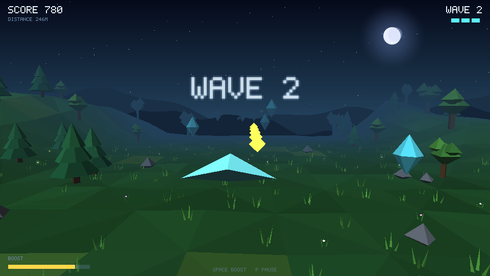

# MLFTP: machine-learned frame-time prediction

Can a game predict a slow frame *before* it happens and lower its quality settings in time? This repo
has a small C++20 engine with two games on top of it, plus the research code that logs frames,
trains small predictors and tests them in a closed loop.

- **Spark Engine** (`engine/`): a 2D engine with a CPU software renderer (X11), ECS, a fixed 60 Hz
  timestep, per-frame logging, a model runtime (`.spkm` files) and a quality controller.
- **Spark Warden** (`game/`): a top-down arena shooter, with a bot for headless data collection.
- **Spark Drift** (`game3d/`): a 3D glider game with its own software rasterizer (z-buffer, near-plane
  clipping, Gouraud shading, fog) and a procedural night valley.
- **Research** (`research/frametime/`): data collection, feature extraction (bit-exact in Python and
  C++), training, evaluation, a controller simulator and playtest benchmarks.



## How it works

Each frame, before any work runs, the engine builds a 64-value feature vector:

- the planned work (sim steps, entity and particle counts, spawns due);
- the quality setting being considered and pixel estimates;
- recent frame times;
- CPU clock and context switches;
- a hardware fingerprint.

A model predicts the p50, p95 and p99 frame time and the probability of missing the 16.67 ms
budget. The controller then picks the best quality level whose predicted p95 fits. There are four
quality levers: render scale, particle density, glow, and anti-aliasing.

## Results so far

All data comes from one laptop (Intel i5-13500H): 103 bot sessions, 263,609 frames (62.8 MB). The
split is by session: 71 train, 12 validation and 20 test sessions. The dataset and trained
checkpoints are not in this repo.

**Offline (test sessions):**

| model | params | MAE (ms) | p95 coverage (target 0.95) | in-game cost |
|---|---|---|---|---|
| **online RLS on a cost formula** (`rls_hybrid`) | 278 | **0.43** | 0.97 | ~10–17 µs |
| linear quantile regression (residual) | 260 | 0.46 | 0.95 | ~1 µs (est.) |
| baseline: cost formula only (`naive_ms`) | – | 0.48 | 0.96 | ~1 µs |
| LightGBM quantile trees | 15,564 | 0.50 | 0.96 | ~57–70 µs (over the 50 µs budget) |
| streaming GRU | 13,026 | 0.50 | 0.89 | ~25–40 µs |
| TCN | 11,426 | 0.53 | 0.91 | – |
| MLP 64-64-64 | 8,738 | 0.66 | 0.91 | – |

**Best working model: `rls_hybrid`.** It is a 15-feature linear correction on top of an analytic
cost formula. Recursive least squares refits it every frame, with a forgetting factor of 0.99, so it
effectively remembers about the last 100 frames. Adaptive conformal offsets give the p95/p99. It is
the most accurate model, well calibrated, cheap, and it adapts while the game runs. The neural
networks are under-confident in their p95 (coverage 0.89–0.91). **No model predicts sudden spikes
well:** p95 coverage on spike frames is 0.2–0.5.

**Closed loop (headless, real-time 60 Hz loop, 3 seeds × 40 s per setting):**

- **Against no controller:** under heavy load the uncontrolled game drops to 32–46 fps. Every
  controller holds about 59.5 fps.
- **Against the engine's reactive (non-ML) controller at equal quality:** no clear win.
  - At one stress level, RLS has 2.5 vs 9.5 stutters/min at nearly the same quality. Interpolated
    to exactly equal quality, it is 8.7 vs 9.5.
  - At a heavier level, the models trade about half a quality step for 30–60% fewer stutters.
  - The earlier "10× fewer stutters" came mostly from running at lower quality.

**What carries the signal:** recent frame times and engine-level work estimates (pixels to draw at
the candidate quality). The importance study drops all 23 game-specific counters (enemies, waves,
spawn warnings). A "planned work only" model is the worst variant. In this game, frame cost changes
slowly and spikes come from OS and background noise, so reacting fast is nearly as good as
predicting. Lever costs: render scale 38% and glow 35% of frame cost; AA 1.3%; particles 0.1%.

**Hardware agnosticity (open).** The RLS model is hardware-*adaptive*: the cost formula and the
weights re-fit online.
- **Tested so far:** a performance-core vs efficiency-core run on the same laptop (about 1.9×
  slower). RLS coverage dips to 0.95 in the first 5 s, then recovers to 0.98. The non-adaptive tree
  model also stayed calibrated, so this test does not separate them.
- **Not tested yet:** a different chip.

**Game agnosticity (open).**
- **Expected:** a model without the 23 game-specific features would carry to other games on this
  engine. That model has not been trained yet.
- **Spark Drift today:** it has the quality ladder and the reactive controller. Under heavy load
  reactive holds 59.5 fps where no controller gives 29.5. It has no learned model yet, because its
  frame cost depends on the 3D scene, which needs new features.

## Build and run

Linux with X11 dev headers, g++ 13+ (C++20). Python 3.10+ for the research code.

```bash
SRC=$(ls engine/*.cpp | grep -v window_null.cpp)      # window_null.cpp = headless-only builds
g++ -std=c++20 -O2 -Iengine $SRC game/*.cpp   -o spark_warden -lX11 -lXext -lpthread
g++ -std=c++20 -O2 -Iengine $SRC game3d/*.cpp -o spark_drift  -lX11 -lXext -lpthread

./spark_warden                                   # play (window)
./spark_drift --out-scale 2 --ctl reactive --stats
./spark_warden --headless --bot --frames 7200    # headless self-check
```

The game options are in `--help`. These are the useful ones:
- research: `--log`, `--model <checkpoint>`, `--ctl fixed|reactive|model`, `--quality Ln`,
  `--ctl-margin`;
- stress: `--out-scale`, `--spawn-mult`, `--burst-mult`, `--contend`;
- timing: `--loop paced`.

**Tests**
```bash
g++ -std=c++20 -O2 -Iengine $SRC tests/*.cpp game/bot.cpp game/play.cpp game/scenes.cpp -o test_engine -lX11 -lXext -lpthread && ./test_engine
g++ -std=c++20 -O2 -Iengine $SRC game3d/tests/*.cpp $(ls game3d/*.cpp | grep -v main.cpp) -o test_3d -lX11 -lXext -lpthread && ./test_3d
pip install -r research/frametime/train/requirements-cpu.txt
cd research/frametime/train && python -m unittest discover -s tests   # some tests need a dataset
```

## Layout

```
engine/                      engine, model runtime (predictor.*), features, controller, frame log
game/                        Spark Warden (2D)
game3d/                      Spark Drift (3D): r3d renderer, nature scenery, scenes, bot
tests/                       engine and frame-time unit tests (C++)
research/frametime/train/    features, models (linear, RLS, LightGBM, MLP, GRU, TCN), training,
                             evaluation, importance (PCA, permutation, SHAP), controller simulator
research/frametime/tests/    Python <-> C++ parity checks, predictor benchmark
research/frametime/tools/    data collection, checkpoint validation, playtest benchmark
```
